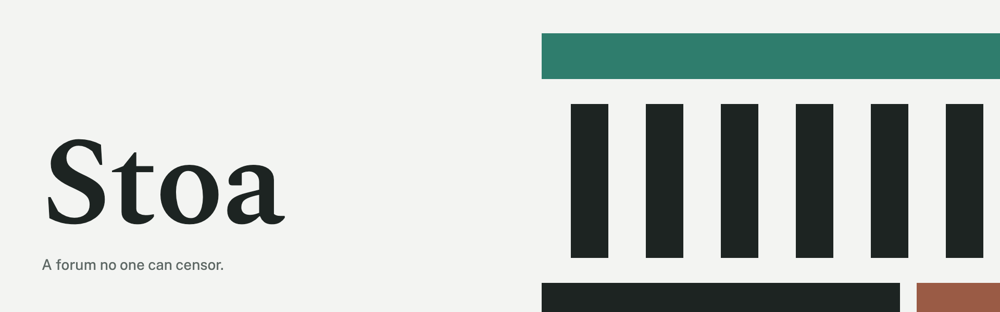

# Stoa brand



Stoa is a forum no one can censor. Its communities, posts and votes live on Lattice chains, and each reader's own client reads them, checks them and decides what to show. A stoa was the covered colonnade of a Greek city, where anyone could walk in and speak. The brand takes three things from it: a shared roof held up by many independent columns, stone-pale grounds, and bronze that has weathered to patina.

These are Stoa's brand guidelines: the logo, color and typography, with the files to use. This page gives the principles and the voice.

## Principles

- **Quiet ground, one green.** Pages are Limestone (`bg`) and Marble (`surface`) with `ink` text. Patina (`accent`) marks what can be acted on. Rust (`down`) and Ochre (`warn`) appear only to signal a state.
- **Borders, not shadows.** Objects separate by a 1px `line` hairline and a step from `bg` to `surface`. Nothing floats, and nothing uses a gradient.
- **Type does the hierarchy.** Spectral 600 for what you read first, Public Sans for everything else, JetBrains Mono for anything a person copies and compares.
- **Nothing hidden behind color.** Every state color comes with a word or a glyph: the down arrow, "Collapsed", "Pending".
- **Self-hosted.** The fonts and marks ship with the page, so no font host or CDN learns who reads Stoa. Keep it that way in anything built on the brand.

## Voice

Write plainly and say what happens. Use short, active sentences, and say "you" to the reader. Name what was done and what to do next, without apology or alarm.

- "You declined it in Selfhold. Nothing was sent."
- "Follows are signed by your account, so every app can read them."
- "The sponsor couldn't pay this fee. Try again in a few minutes."
- "Stoa is still reading the communities from the node. Try again in a moment."

Rules:
- Sentence case everywhere: buttons, headings, menus ("Continue with Selfhold", "Your communities"). See Typography for the exceptions.
- Say what a thing does for the reader, not how it is built. Use "Your votes count here", not "You are in the PageRank member set".
- Avoid exclamation marks, emoji and hype words ("revolutionary", "web3"). A plain claim sounds more confident.
- Use proper names as they are: Stoa, Lattice, Selfhold, Moniker, Follows. Communities are written `s/<name>` and people `@handle`, both lowercase.


## Guidelines

- [Logo](docs/logo.md): the suite, construction, clear space, minimum sizes, favicons, and the do's and don'ts.
- [Color](docs/color.md): primary, secondary and accent colors in HEX, RGB and CMYK, with contrast and accessibility rules.
- [Typography](docs/typography.md): families, weights, sizes, case and web-safe fallbacks.

## Files

| Folder | What |
|---|---|
| `logos/` | Every logo as SVG: primary, reversed, white, stacked, the mark, the wordmark and the 16px mark |
| `favicons/` | `favicon.svg`, PNGs at 16, 32, 180 and 512, and their SVG sources |
| `fonts/` | Spectral, Public Sans and JetBrains Mono as WOFF2, with their licenses |
| `tokens.json` | Every color (light and dark), type style, spacing step and radius, with usage notes |
| `tokens.css` | The same tokens as CSS custom properties, with the `@font-face` rules |
| `source/` | `marks.py` draws every logo and favicon from one geometry; `tokens.py` writes `tokens.css` |

Use the logo files as they are. Never redraw or retype them. Build both themes from the tokens, never from literal hex values.

```sh
pip install fonttools brotli
python3 source/marks.py          # logos/ and favicons/ SVGs
python3 source/tokens.py > tokens.css
```

## License

MIT, except the fonts, which are under the SIL Open Font License 1.1 (`fonts/OFL-*.txt`).
