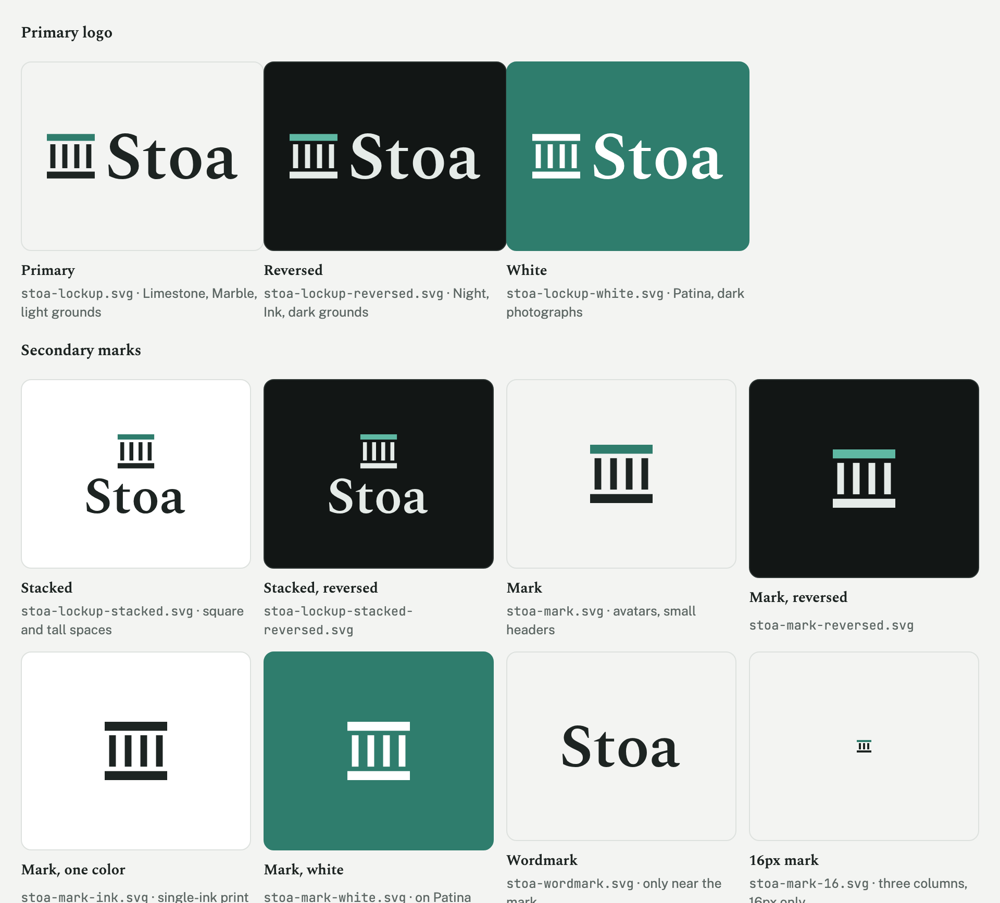
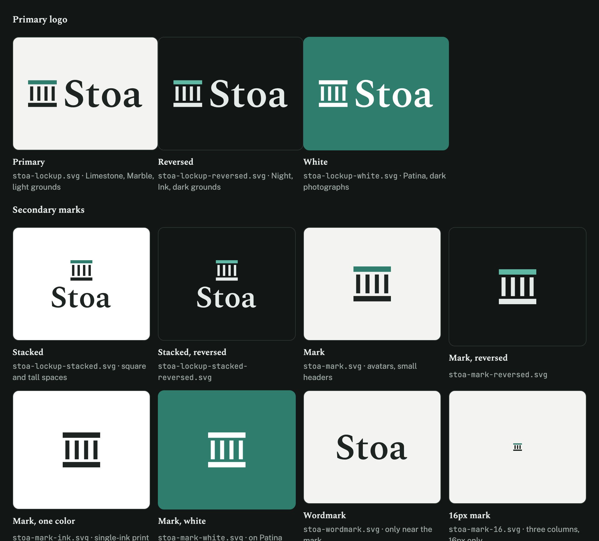
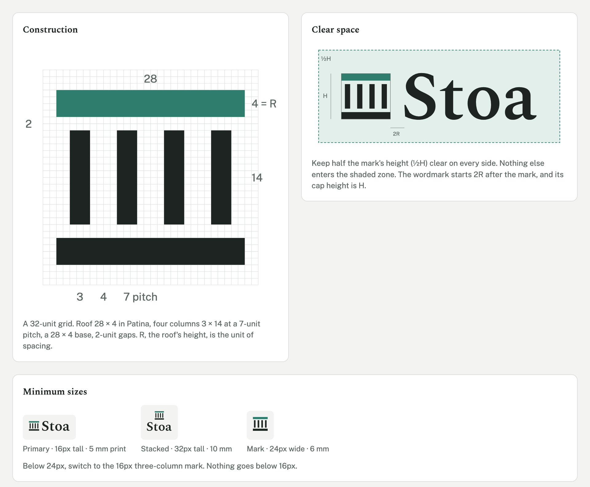
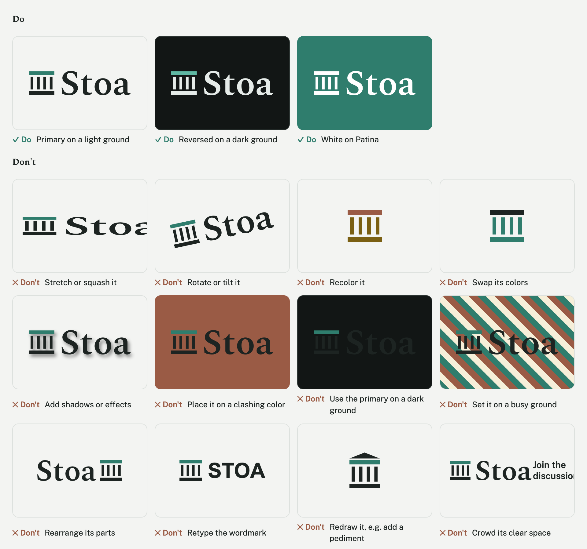
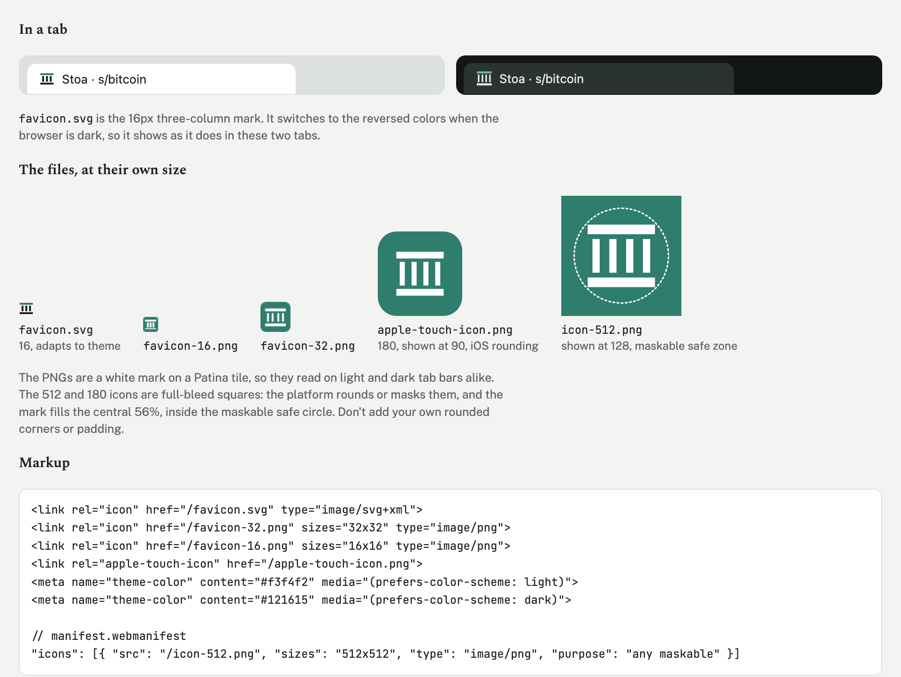

# Logo

The mark is a stoa seen from the front: a flat roof on four columns, standing on a base. The roof is Patina; the columns and base are Ink. It has no pediment: a stoa is a walkway open to everyone, not a temple or a bank.

## The suite





| File | What it is | Use it |
|---|---|---|
| [`stoa-lockup.svg`](../logos/stoa-lockup.svg) | **Primary logo**: the mark, then the wordmark | The default everywhere: site header, documents, slides, social profiles. On Limestone, Marble or any light, calm ground. |
| [`stoa-lockup-reversed.svg`](../logos/stoa-lockup-reversed.svg) | Primary, for dark grounds | On Night (`bg`, dark), Ink, or dark photography. Lighter Patina roof, Ink-light columns. |
| [`stoa-lockup-white.svg`](../logos/stoa-lockup-white.svg) | Primary, one color white | On a Patina fill, or on a dark photo where two colors would clash. |
| [`stoa-lockup-stacked.svg`](../logos/stoa-lockup-stacked.svg), `…-stacked-reversed.svg` | **Secondary**: the mark above the wordmark | Square and tall spaces: avatars with room for the name, title slides, stickers, merchandise. |
| [`stoa-mark.svg`](../logos/stoa-mark.svg), `…-reversed.svg` | **Secondary**: the mark alone | Where the name is already present or the space is small: the app header on phones, social avatars, watermarks. |
| [`stoa-mark-ink.svg`](../logos/stoa-mark-ink.svg), `stoa-mark-white.svg` | The mark in one color | Single-color printing, embossing, engraving, fax-quality reproduction. |
| [`stoa-wordmark.svg`](../logos/stoa-wordmark.svg) | The wordmark alone | Only where the mark already appears nearby, such as the footer of a page whose header has the mark. Never as the only identifier. |
| [`stoa-mark-16.svg`](../logos/stoa-mark-16.svg) | **Small-size mark**: three columns on whole pixels | 16px only: tab icons, inline badges. |

The wordmark is "Stoa" in Spectral SemiBold, converted to outlines. It is never retyped: live text renders differently from browser to browser.

## Construction



The mark is drawn on a 32-unit grid and spans 28 × 26 units.

- **Roof:** 28 × 4, Patina.
- **Columns:** four, each 3 × 14, at a 7-unit pitch, starting 2 units in from each end of the roof.
- **Base:** 28 × 4.
- **Gaps:** 2 units between the roof and the columns, and between the columns and the base.

The roof's height, **R**, is the unit for everything around the mark: R = 4/26 of the mark's height, or about 0.15 of it.

In the lockup, the wordmark's cap height equals the mark's height, and its baseline sits on the bottom of the base. The wordmark starts 2R after the mark. The primary lockup is about 4.2 times as wide as it is tall, and the stacked lockup about 1.25 times.

## Clear space

Keep **half the mark's height** clear on every side, measured from the outermost edges of the mark and the wordmark. No text, image edge, rule or other logo enters it. For a primary lockup 40px tall, that is 20px of clear space all round. The same rule applies to the mark alone and to the stacked lockup, where the measure is still the mark's height.

## Minimum sizes

| Asset | Digital | Print |
|---|---|---|
| Primary lockup | 16px tall (67px wide) | 5 mm tall |
| Stacked lockup | 32px tall | 10 mm tall |
| Mark, four columns | 24px wide | 6 mm wide |
| Mark below 24px | [`stoa-mark-16.svg`](../logos/stoa-mark-16.svg) at exactly 16px | Not used in print |

Below these sizes, the gaps between the columns close up and the wordmark's serifs break apart. Never use anything smaller than 16px.

## Color on grounds

| Ground | Logo |
|---|---|
| Limestone `#f3f4f2`, Marble `#ffffff`, any light neutral | Primary: Patina and Ink |
| Night `#121615`, Ink `#1d2422`, any dark neutral | Reversed |
| Patina `#2f7d6d` | White, one color |
| A photograph | White on a dark, calm area, or Ink on a light, calm area. Never across faces, text or busy detail. |
| One-ink print | Ink, or the print's single ink |

## Do's and don'ts



## Do

- Use the supplied files at their own proportions, scaled from a corner.
- Keep the clear space, even when space is tight. Choose a smaller size before a tighter margin.
- Choose the version by the ground: primary on light grounds, reversed on dark ones, white on Patina.
- Use the stacked lockup or the mark alone when the primary lockup would have to go below its minimum size.

## Don't

- **Stretch, squash or skew it.** Scale it proportionally only.
- **Rotate or tilt it.** The roof is always level.
- **Recolor it.** Don't put the roof in Rust or Ochre, use brand colors outside the four approved schemes, or apply gradients.
- **Swap the two colors.** Patina is always the roof and never the columns.
- **Add effects:** drop shadows, glows, outlines, bevels or transparency.
- **Place it on a clashing ground.** That includes the two-color logo on Patina, Rust or Ochre, the primary logo on a dark ground, and any version on a busy pattern or photo detail.
- **Rearrange it.** Don't put the wordmark before the mark, change the gap, or set the wordmark smaller or larger against the mark.
- **Retype the wordmark** in another font or weight, or change it to "STOA" or "stoa".
- **Redraw the mark.** Don't add a pediment, change the number of columns at sizes above 24px, or round the corners.
- **Enlarge the 16px mark.** Its three columns are only for 16px.

## Favicons



Stoa's tab, home-screen and app icons, and the markup that loads them.

- `favicon.svg` is the primary favicon: the 16px three-column mark, which switches to the reversed colors in a dark browser.
- `favicon-32.png` and `favicon-16.png` are fallbacks for browsers that don't take SVG icons: a white mark on a Patina tile.
- `apple-touch-icon.png` (180) and `icon-512.png` are full-bleed Patina squares with the white mark in the central 56%. They are safe for iOS rounding and Android's maskable icons. Don't add corners or padding.
- Set `theme-color` to `bg`: `#f3f4f2` in light and `#121615` in dark.

```html
<link rel="icon" href="/favicon.svg" type="image/svg+xml">
<link rel="icon" href="/favicon-32.png" sizes="32x32" type="image/png">
<link rel="icon" href="/favicon-16.png" sizes="16x16" type="image/png">
<link rel="apple-touch-icon" href="/apple-touch-icon.png">
<meta name="theme-color" content="#f3f4f2" media="(prefers-color-scheme: light)">
<meta name="theme-color" content="#121615" media="(prefers-color-scheme: dark)">
```

In a web app manifest: `"icons": [{ "src": "/icon-512.png", "sizes": "512x512", "type": "image/png", "purpose": "any maskable" }]`.
